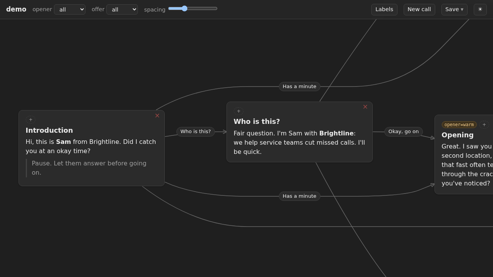

# call_scripters 

[](https://crates.io/crates/call_scripters)
[](https://docs.rs/call_scripters)

<br>
[](https://github.com/ev-main/call_scripters/actions?query=branch%3Amain) <!--NB: Won't find it if repo is private-->
[](https://github.com/ev-main/call_scripters/actions?query=branch%3Amain) <!--NB: Won't find it if repo is private-->

🌐 **[Live demo](https://ev-main.github.io/call_scripters/)** — the demo script, built; no setup, runs in the browser.

Turns a markdown sales call script into one self-contained HTML file: each `# ` section becomes a card, response links become edges, and the caller clicks through the conversation graph during a live call, picking A/B variants as they go. The file works offline, can be edited inline, and saves a new copy of itself.



[`examples/demo.md`](examples/demo.md), walked: A/B variants picked in the top bar, responses clicked through to a booked call, then a card's markdown edited in place. For the real thing, [play with it](https://ev-main.github.io/call_scripters/).
// redraw it yourself: `nix run .#film`.
<!-- markdownlint-disable -->
<details>
<summary>
<h2>Installation</h2>
</summary>

```sh
cargo binstall call_scripters # prebuilt: linux x86_64, macOS aarch64
cargo install call_scripters
nix profile install github:ev-main/call_scripters # substituted from valeratrades.cachix.org
```


</details>
<!-- markdownlint-restore -->

## Usage
```sh
call_scripters build script.md --direction vertical   # or horizontal; writes /tmp/call_scripters/script.html (-o to override)
call_scripters watch script.md   # serves it on localhost and opens it; the page reloads on each save of the md, its Ctrl+S writes the md
```
Open the html in any browser. Click cards or responses to follow the call, pick variants and layout spacing in the top bar, zoom with − / + (`-`, `+` or `=`), Ctrl+scroll or a pinch, double-click a card to edit its markdown (Ctrl+Enter commits, Esc cancels), `n` starts a new call: the view jumps to each card you click until Clear (Esc outside an edit) ends the call and clears the walked path; × or Backspace deletes the current card, Labels (`l`) in the top bar defines labels that cards carry. Ctrl+S overwrites the opened file (Chromium asks for it once; under `watch`, the md), Save ▾ (`s`) downloads a copy as .html or .md; hovering a bar control shows its hint and keys; ☾/☀ switches theme. Format: [docs/spec/script_format.md](docs/spec/script_format.md).

`nix run . -- [script.md] [--direction horizontal]` watches the script (the demo by default).


<br>

<sup>
	This repository follows <a href="https://github.com/valeratrades/.github/tree/master/best_practices">my best practices</a> and <a href="https://github.com/tigerbeetle/tigerbeetle/blob/main/docs/TIGER_STYLE.md">Tiger Style</a> (except "proper capitalization for acronyms": (VsrState, not VSRState) and formatting). For project's architecture, see <a href="./docs/ARCHITECTURE.md">ARCHITECTURE.md</a>.
</sup>

#### License

<sup>
	Licensed under <a href="LICENSE">Blue Oak 1.0.0</a>
</sup>

<br>

<sub>
	Unless you explicitly state otherwise, any contribution intentionally submitted
for inclusion in this crate by you, as defined in the Apache-2.0 license, shall
be licensed as above, without any additional terms or conditions.
</sub>

